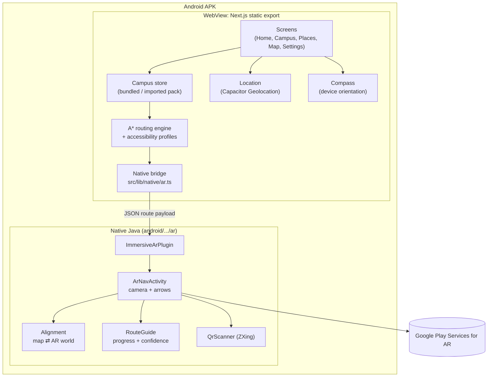
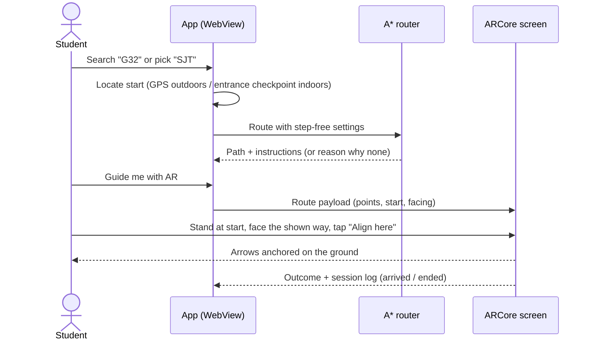
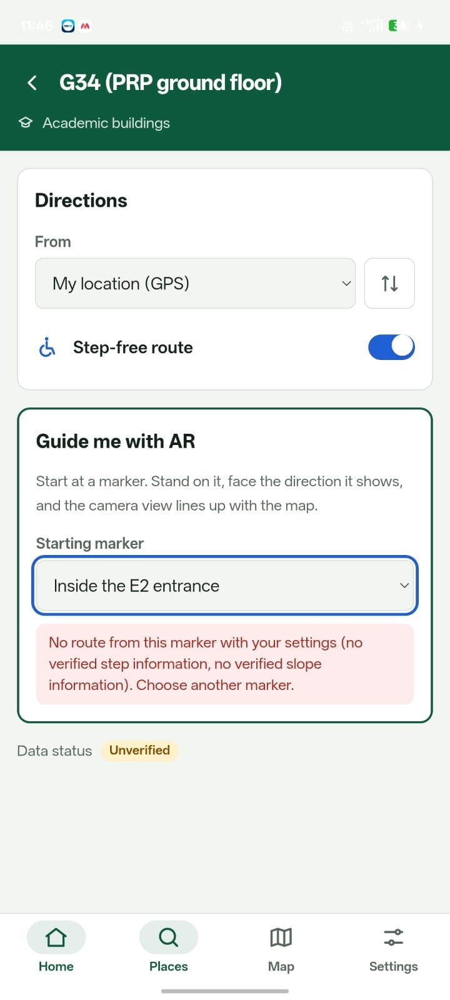
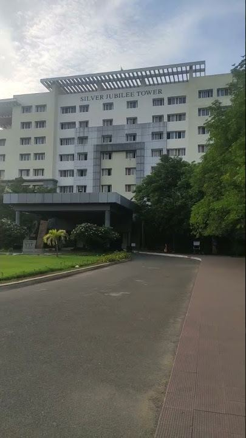
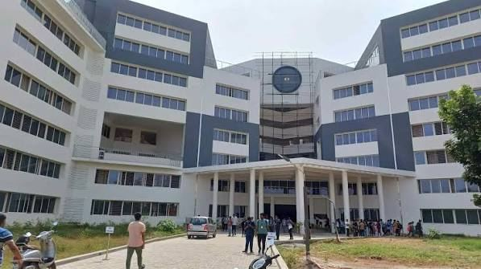

# VIT ImmersiveAR – Augmented Reality Campus Navigation for VIT Vellore

An Android app that guides students and visitors around the VIT Vellore campus
with **AR arrows drawn on the ground through the phone camera**: outdoors to
campus blocks (SJT, TT, SMV, PRP and more), and indoors to classrooms (PRP
ground-floor pilot). Routes are planned with **A\*** and can be restricted to
**step-free** paths. Everything runs **offline** on the phone.

Built with **Next.js + TypeScript** (screens), **Capacitor** (Android packaging)
and **Google ARCore** in native Java (augmented reality).

> Academic project. Not an official VIT app. Campus data is labelled by source
> and verification status inside the app (see [Current limitations](#current-limitations)).

---

## Contents
1. [Problem statement](#problem-statement)
2. [Proposed solution](#proposed-solution)
3. [Key features](#key-features)
4. [Technology stack](#technology-stack)
5. [System architecture](#system-architecture)
6. [Application workflow](#application-workflow)
7. [A\* pathfinding](#a-pathfinding)
8. [Outdoor navigation](#outdoor-navigation)
9. [Indoor navigation (PRP pilot)](#indoor-navigation-prp-pilot)
10. [Accessibility](#accessibility)
11. [Offline and privacy](#offline-and-privacy)
12. [Installation and setup](#installation-and-setup)
13. [Build the Android APK](#build-the-android-apk)
14. [Screenshots](#screenshots)
15. [Testing](#testing)
16. [Current limitations](#current-limitations)
17. [Future enhancements](#future-enhancements)
18. [Project structure](#project-structure)
19. [Team](#team)

---

## Problem statement
- **A large campus.** New students and visitors struggle to find blocks such as SJT, TT, SMV and PRP, and rooms inside them.
- **2D maps stop at the door.** General map apps show the building, not the classroom, and GPS does not work indoors.
- **Accessibility is missing.** Common maps do not say where steps, lifts or ramps are, so wheelchair users can be sent along unsafe routes.

## Proposed solution
One installable Android app that:
- finds any listed block, room, hostel or facility by search;
- shows AR arrows on the ground from where the user is standing;
- guides indoors to the classroom (PRP ground floor, pilot);
- plans step-free routes and explains why when none exists;
- works without internet and sends no data to any server.

## Key features
| Feature | Where in the app | Status |
|---|---|---|
| Search places and browse by type | Places tab | Working |
| A\* routing with step-free, slope, surface and access rules | Place → Directions | Working, unit-tested |
| Turn-by-turn text directions | Place → Directions | Working |
| **Outdoor AR guidance** to campus blocks (GPS + compass + ARCore) | Campus → building → *Guide me with AR camera* | Working on device; accuracy limited by GPS/compass |
| Compass arrow with distance and arrival (no camera) | Campus → building → *Compass arrow* | Working |
| **Indoor AR guidance** from an entrance checkpoint | Places → G31–G34 → *Guide me with AR* | Working on device (PRP ground floor) |
| AR reliability checks: hide arrows when tracking is lost, warn on drift, re-align | AR guidance screen | Working, unit-tested |
| QR checkpoint markers (scan to select, re-align) | AR guidance screen | Implemented; markers not yet installed on campus |
| Offline campus map (SVG) with live GPS position | Map tab | Working |
| Import a campus data pack without rebuilding | Settings → Offline campus data | Working |
| Save a place's location and photo on site | Campus → place → *I'm here* / *Take a photo* | Working |
| Research session logs, CSV/JSON export | Settings → Research sessions | Working |

## Technology stack
| Layer | Technology (versions from the project) |
|---|---|
| UI | Next.js 16 (App Router, static export), React 19, TypeScript 5.9, Tailwind CSS 4 |
| Packaging | Capacitor 8 (`@capacitor/android`, `@capacitor/app`, `@capacitor/geolocation`) |
| AR | Google ARCore 1.54 (Java, OpenGL ES 2.0 renderers), custom Capacitor plugin `ImmersiveAr` |
| QR markers | ZXing core 3.5.3 |
| Routing | Own A\* engine in TypeScript (`src/lib/routing`) |
| Storage | IndexedDB and localStorage (on the phone only) |
| Tests | Node.js built-in test runner (`node --test`), JUnit 4 (Android) |
| Map data | OpenStreetMap building positions (© OpenStreetMap contributors, ODbL); own field survey for PRP |

No Unity, Firebase, ARKit or Vuforia is used.

## System architecture

More detail: [docs/ARCHITECTURE.md](docs/ARCHITECTURE.md).

## Application workflow


## A\* pathfinding
The campus is a graph of **nodes** (entrances, junctions, rooms, stairs, lifts)
and **edges** (paths, corridors, doors, stairs, ramps, lifts), with positions in
metres east/north of a map origin.

- **Cost** = walking time expressed in metres. Stairs cost more (÷0.5 speed), a lift adds 45 s; soft preferences (avoid unpaved, prefer covered) multiply the cost by ≥ 1.
- **Heuristic** = straight-line distance, which never overestimates because every edge is at least as long as the straight line (enforced by data validation). So A\* returns the cheapest path.
- **Hard rules** remove edges before searching: steps when step-free is on (**unknown steps count as not step-free**), slopes above 8.33 % (1:12), closed paths, and residents-only paths for non-residents.
- If no route exists, the app reports which rule blocked it.

Code: [`src/lib/routing`](src/lib/routing). Tests compare A\* with a brute-force search on 1,500 random graphs.

## Outdoor navigation
1. The building's position comes from OpenStreetMap (building centre) or from a GPS point saved on site.
2. The phone's GPS gives the start position; its accuracy is shown, and a fix worse than ±30 m is refused.
3. With the phone held flat, the compass gives the direction the user faces.
4. The app sends ARCore a straight-line route (a point every 10 m) starting at the user, facing that direction.
5. The user taps **Align here**; ARCore anchors amber arrows on the ground towards the building.

Without a camera, a **compass arrow** shows direction, distance and "You have arrived".
Code: [`src/lib/landmarks`](src/lib/landmarks), [`src/app/landmark`](src/app/landmark).

## Indoor navigation (PRP pilot)
GPS cannot work indoors, so the AR world is lined up at a known **checkpoint**:
1. The PRP ground floor was surveyed by step count (0.7 m per step) and video: E2 entrance, main corridor, G31, G32, G33, G34.
2. The survey is stored as a campus data pack ([`survey/prp-e2-ground.campus.json`](survey/prp-e2-ground.campus.json)) and imported in Settings.
3. The student stands just inside the E2 entrance facing into the building and taps **Align here**.
4. `Alignment` maps the survey's coordinates into ARCore's world; `RouteGuide` tracks progress and turns.

Format of a campus pack: [docs/CAMPUS-DATA.md](docs/CAMPUS-DATA.md).

## Accessibility
- **Step-free routes** switch: routes avoid steps and slopes steeper than 1:12.
- **Unknown is not safe**: paths not yet surveyed are never treated as step-free.
- **Explanations** instead of silent failure ("no verified step information").
- Large touch targets, screen-reader labels, high-contrast text, reduced-motion support.

## Offline and privacy
- The app is a static export inside the APK: screens, maps, routing and AR need no internet (ARCore itself must be installed once from the Play Store).
- Location is used only while a screen needs it, kept in memory, never uploaded.
- Saved places, photos and research logs stay on the phone and can be deleted in the app.
- No accounts, analytics, ads or API keys. See [docs/PRIVACY.md](docs/PRIVACY.md) and [docs/SECURITY.md](docs/SECURITY.md).

## Installation and setup
**Requirements:** Windows 10/11 (macOS/Linux also work), Node.js 22+, Git,
Android Studio (includes JDK 21 and Android SDK 36), an
[ARCore-supported phone](https://developers.google.com/ar/devices). Tested on a realme P3 5G (Android 16).

Use a folder path **without spaces**.

```powershell
git clone https://github.com/SharunKumarD/VIT_Campus_Tour_Using_AR.git
cd VIT_Campus_Tour_Using_AR
npm install
node setup-ar.mjs        # adds ARCore, ZXing, permissions and AR screens to the Android project (safe to re-run)
npm test
npm run dev              # browser preview at http://localhost:3000 (AR needs the Android app)
```

## Build the Android APK
Phone connected by USB with **USB debugging** on:

```powershell
npm run build
npx cap sync android
cd android
.\gradlew.bat testDebugUnitTest
.\gradlew.bat assembleDebug
adb install -r app\build\outputs\apk\debug\app-debug.apk
cd ..
```

If Gradle cannot find Java 21, point it to Android Studio's JDK:
```powershell
$env:JAVA_HOME = "C:\Program Files\Android\Android Studio\jbr"
```

To load the PRP indoor map: copy `survey/prp-e2-ground.campus.json` to the phone,
then **Settings → Offline campus data → Import**.

Signed release builds: see [docs/SECURITY.md](docs/SECURITY.md). Never commit keystores.

## Screenshots
| Directions with step-free check (PRP, G34) | Campus photos used in the app |
|---|---|
|  |   |

More screenshots of the AR screens can be added to [`screenshots/`](screenshots).

## Testing
| Command | What it checks |
|---|---|
| `npm test` | Routing (A\* vs brute force), accessibility rules, data validation, search, GPS handling, outdoor AR payloads, AR route payloads, session export |
| `npm run build` | TypeScript type check and production static export |
| `.\gradlew.bat testDebugUnitTest` (in `android`) | Alignment maths, AR guidance modes, QR handling (JUnit) |

On-device checks: [docs/RESEARCH-PROTOCOL.md](docs/RESEARCH-PROTOCOL.md). Status of every requirement: [docs/STATUS.md](docs/STATUS.md).

## Current limitations
- Building positions are OpenStreetMap **building centres**; MGR Block is not in OpenStreetMap yet.
- Outdoor arrows follow a **straight line**, and GPS (±5–15 m) and compass (±5–15°) errors apply.
- Indoor map covers **one floor of PRP**, from step counts, labelled *unverified*.
- AR arrows are not hidden behind walls (no occlusion); floor changes need re-alignment.
- Tested on one phone model.
- Some building photos in `public/photos` were supplied for the demo; replace them with your own or authorised photos before any public release.

## Future enhancements
- All PRP floors and other blocks indoors, verified with VIT Estates.
- QR / wall markers at entrances and stair landings for exact alignment.
- ARCore Geospatial API (Google VPS) for precise outdoor alignment.
- Routing along real footpaths outdoors.
- Voice guidance in English, Tamil and Hindi.
- User study with wheelchair users, after ethics committee approval.

## Project structure
```
src/app/             Screens: home, campus (landmarks), places, place, map, settings, offline, research, ar-check
src/components/      UI components (map, AR guidance section, navigation bar, icons)
src/lib/campus/      Campus data model, validation, demo pack, search, store
src/lib/routing/     A*, accessibility profiles, turn-by-turn instructions, geometry
src/lib/landmarks/   Campus buildings, outdoor AR payload, compass, distance/bearing
src/lib/location/    GPS fixes, accuracy classes, snapping
src/lib/native/      Bridge to the native AR plugin, route payloads
src/lib/offline/     IndexedDB storage
src/lib/research/    Session logs and CSV export
public/photos/       Building photos shown in the app
tests/               Node tests
survey/              PRP field survey and the script that builds its campus pack
android/             Capacitor Android project; native ARCore code in app/src/main/java/dev/sainikhil/immersivear/ar
docs/                Architecture, data format, methodology, privacy, security, status, demo script
screenshots/         Screenshots of the running app
setup-ar.mjs         One-time Android setup for ARCore
```

## Team
| Name | Register number |
|---|---|
| Sharun Kumar D | 23MID0131 |
| G Sai Nikhil | 23MID0194 |
| T Mathan | 23MID0425 |

Vellore Institute of Technology (VIT), Vellore.

## Licence and data
Code licence: see [LICENSE](LICENSE) (add one before publishing; see note in the repository).
Map data © OpenStreetMap contributors, available under the Open Database Licence (ODbL).
Third-party licences: [docs/COMPLIANCE.md](docs/COMPLIANCE.md).
