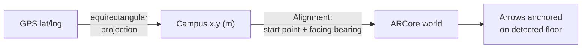
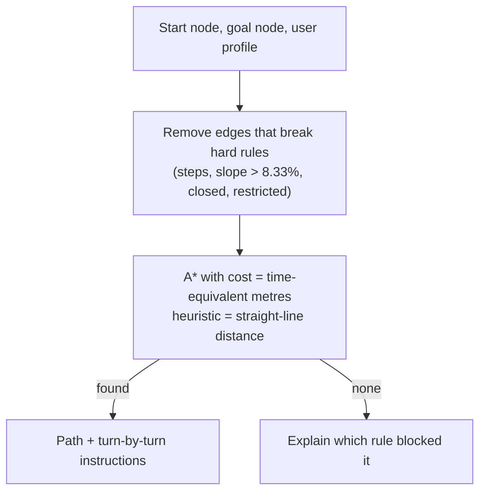

# Methodology

How positions, routes and AR arrows are produced. Every step below exists in the code; file names are given so it can be checked.

## 1. Coordinate frames
| Frame | Meaning | Code |
|---|---|---|
| WGS84 | GPS latitude / longitude | `src/lib/routing/geo.ts` |
| Campus | metres east (x) / north (y) of the pack origin | `src/lib/campus/types.ts` |
| AR world | ARCore's own frame, fixed when the user taps *Align here* | `android/.../ar/Alignment.java` |

## 2. Data collection
- **Outdoor buildings:** OpenStreetMap building outlines, centre point (fetched 29 Oct 2026). Credited in the app.
- **PRP E2 entrance:** phone GPS reading taken on site (12.971579, 79.165686).
- **PRP ground floor:** step counts from the entrance (step length 0.7 m, from height 170 cm × 0.415), plus video to check turns and steps. Script: `survey/build-prp-pack.ts`.
- **Field guide** for surveying another building: `docs/building-mapping-guide.pdf`.

## 3. Routing (A\*)

Code: `src/lib/routing/astar.ts`, `profile.ts`, `route.ts`, `instructions.ts`.

## 4. Outdoor AR guidance
1. GPS fix (must be ±30 m or better) → start point.
2. Compass heading, phone held flat → facing direction (`src/lib/landmarks/useCompass.ts`).
3. Straight-line route with a point every 10 m (`src/lib/landmarks/outdoor-ar.ts`).
4. Native AR screen aligns at the start and draws arrows. Policy `always`: arrows stay visible on long walks, with drift warnings.

## 5. Indoor AR guidance
1. Route from the entrance checkpoint to the classroom (A\*).
2. User stands at the checkpoint, faces the stated direction, taps *Align here*.
3. `RouteGuide` modes: ALIGNING → GUIDING → DEGRADED (≥ 40 m since alignment) → LOST (tracking lost > 1.5 s or ≥ 80 m) → ARRIVED (≤ 3 m). Off-route is flagged after 5 m for 3 s; floor changes ask for re-alignment.
4. In the normal (gated) policy, arrows are hidden whenever the position is not trustworthy.

## 6. Evaluation
- Automated: Node tests (`npm test`) and JUnit tests (`gradlew testDebugUnitTest`).
- On device: AR anchoring test, outdoor guidance, PRP indoor guidance; session logs export as CSV for analysis.
- A formal user study needs ethics committee approval first: `docs/RESEARCH-PROTOCOL.md`.
